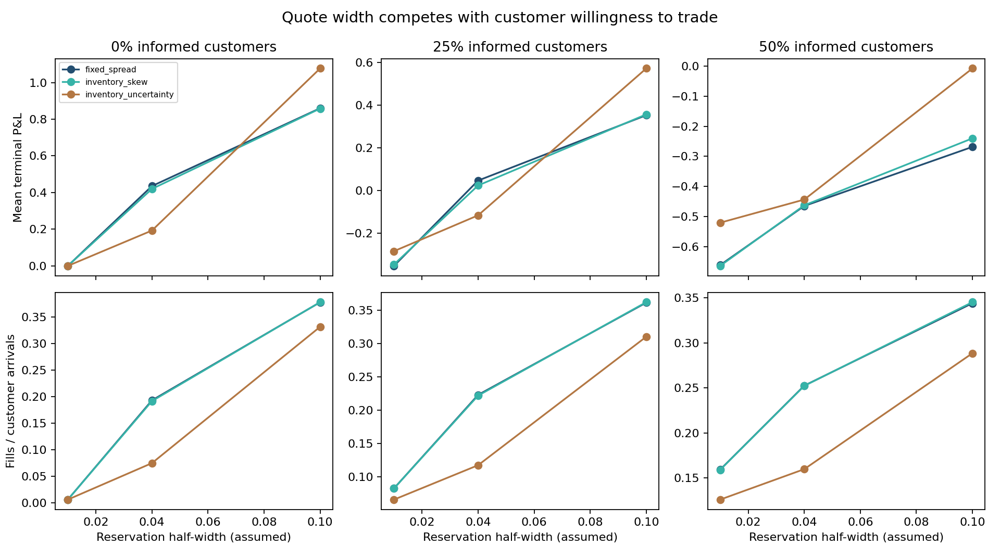
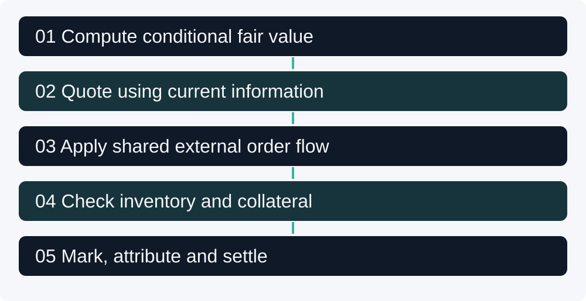
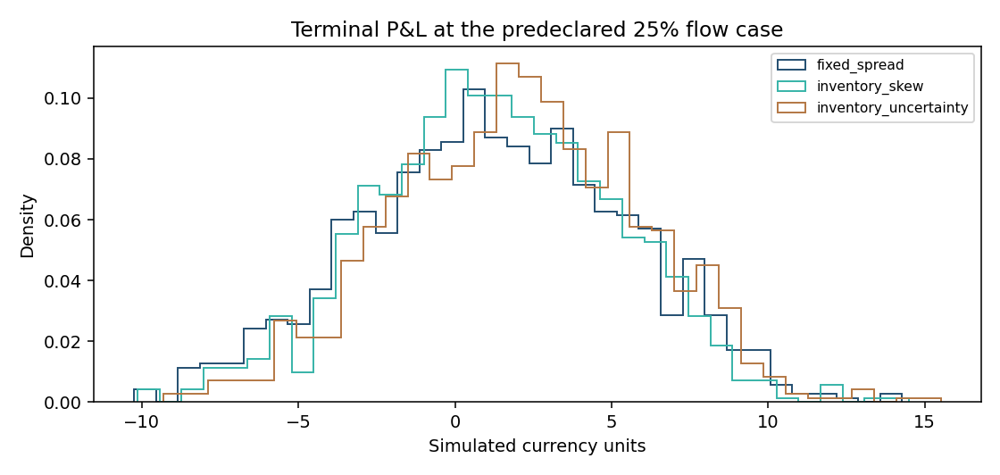

[](https://github.com/Mingju-Zhang-CBS/market-making-lab/actions/workflows/checks.yml)

[Research Studio](https://github.com/Mingju-Zhang-CBS) · [Research map](https://github.com/Mingju-Zhang-CBS/Quant)

# Market Making Lab

**Question:** How do conditional value, inventory, collateral and informed order flow interact in a fully inspectable maker account?

The study implements an independent finite-state binary-contract market, analytical dynamic-programming values, three predeclared quote policies and explicit trade-to-settlement accounting. The project connects mathematical pricing with model risk: every attractive simulation result depends on an assumed customer process.

This work is motivated by my interest in trading and market making, including the Akuna Capital 2026 Virtual Quant Trading Challenge. Its environment, implementation and results are newly constructed; original contest questions, interfaces, opponent code and hidden evaluation are outside this repository.

## Price-sensitive demand

The expanded study reports **108 predetermined scenarios**: three policies, three informed-flow fractions, three reservation widths plus the legacy inelastic case, and three independent seeds. Every scenario uses 1,000 shared paths of 100 steps. Quote coefficients are unchanged.

In the predetermined primary-seed, 25%-informed, width-0.04 case:

|Policy|Mean simulated P&L|Fill rate|Worst-5% loss CVaR|
|---|---:|---:|---:|
|Fixed spread|0.0473|22.31%|3.9489|
|Inventory skew|0.0243|22.20%|2.7769|
|Inventory + uncertainty|-0.1157|11.75%|2.2909|

The wider policy earns more capture per accepted fill but loses uninformed demand and receives worse markouts. Its original inelastic-demand mean-P&L ranking reverses in this scenario. These are assumed customer distributions, not market-calibrated results. All seeds, environments, paired intervals and accounting diagnostics remain in the [executed report](reports/demand/REPORT.md).



```bash
python -m market_making_lab --demand-study --output local-runs/demand
```

## Legacy inelastic-demand baseline

The study compares three policies across 0%, 25% and 50% informed flow using **1,000 shared paths and 100 steps**, producing **nine cases and 9,000 terminal account outcomes**. All policies use the same initial cash, inventory cap and fee.

The model's initial DP value is **0.454545**. An independent 100,000-path check gives **0.453600**, standard error **0.001574**.

For the predeclared 25% informed-flow case, currency amounts per maker account are:

| Policy | Mean P&L | Loss CVaR, worst 5% | Mean absolute inventory |
| --- | ---: | ---: | ---: |
| fixed_spread | 1.273 | 7.287 | 4.842 |
| inventory_skew | 1.293 | 6.666 | 4.493 |
| inventory_uncertainty | 2.049 | 5.910 | 4.583 |

**Research judgment:** inventory-aware rules reduce inventory exposure in this case, but demand assumptions matter. Uninformed customers accept a randomly selected side regardless of quoted spread. Wider quotes therefore receive a mechanical advantage from that part of the model. This is a limitation to explain, not an optimal-spread or real-market profitability conclusion.


## Skills demonstrated

| Capability | Inspectable evidence |
| --- | --- |
| Conditional pricing | Eleven-state transition matrix and backward DP, checked with independent Monte Carlo. |
| Market microstructure reasoning | Current-information quotes, declared next-state information advantage and post-fill markouts. |
| Inventory and capital | Integer unit trades, inventory caps, paid-cash updates and worst-case short collateral. |
| Experimental design | Common state/flow randomness and nine fixed cases; no best-row promotion. |
| Risk measurement | Terminal distribution, loss-tail conventions, inventory occupation and cost attribution. |
| Software verification | Independent cash examples, future-state quote tests and per-step/terminal accounting invariants. |

## Complete simulation workflow



1. Compute the probability of a positive terminal state at each current state and remaining time.
2. Quote using current fair value and inventory; prices are grid-aligned, bounded and noncrossing.
3. Realize the next state and the external customer, using the shared random arrays.
4. Accept a unit fill only if inventory and collateral remain feasible; charge the declared fee.
5. Mark the account, record one-step maker markout and reconcile spread capture, inventory marks and fees.
6. Settle remaining inventory against the same path's terminal binary payout.

The walk moves up/down with probability 0.48 each and stays with 0.04. Attempted moves outside -5 to +5 stay at the boundary. The contract pays one only for a strictly positive terminal state; state zero pays zero, explaining why the initial value is not exactly 0.5.

## The account invariant

```text
Cash after fill = Prior cash - Maker inventory change * Fill price - Fee
Free worst-case collateral = Cash + min(Inventory, 0)
NAV = Cash + Inventory * Fair value
Terminal P&L = Spread capture + Inventory mark changes - Fees
```

The default largest terminal attribution residual is **6.61e-13** currency units. This supports accounting consistency under the declared rules, not a calibrated exchange model. [The walkthrough](docs/WALKTHROUGH.md) derives a complete buy/sell example and a rejected undercollateralized short.



## Reproduce the study

Use **Python 3.12** and an isolated environment:

```text
python -m venv .venv
```

Activate with `.venv\Scripts\Activate.ps1` on Windows PowerShell or `source .venv/bin/activate` on macOS/Linux. Then:

```text
python -m pip install -r requirements.lock.txt
python -m pip install --no-deps -e .
python -m pytest
python -m market_making_lab --demo --output local-runs/demo
```

After installing dependencies, the demonstration runs offline without a GPU, company account, model endpoint or paid API. Use a new or empty output directory. Saved examples in `reports/demo/` contain the recorded run; `local-runs/` and `private-data/` are ignored.

Run `python examples/explain_account.py` to trace paid cash without simulating all cases. The Python interface exposes `Config`, `fair_values`, `shared_paths`, `simulate` and `execute` in [`core.py`](market_making_lab/core.py). Invalid sizes, quote grids, fractional inventory and malformed external path arrays are rejected.

## Outputs and verification

`comparison.csv` contains all nine aggregate rows. `path_results.csv` retains every terminal outcome and P&L component. `sample_ledgers.csv` traces the first path of each case. The manifest binds source, dependencies, configuration and the shared-path fingerprint.

[`test_market.py`](tests/test_market.py) checks independent probability evolution, Monte Carlo agreement, cash/fee arithmetic, short collateral, inventory limits, quote boundaries, future-state isolation, identical-fill fee effects and P&L conservation. Timing describes a local simulation workload before plotting, not order-routing latency.

## Limits and next questions

There is one potential customer per step, no queue, no price-sensitive noise demand, no calibrated arrival intensity and no borrowing or financing spread. Informed takers see the next state by assumption. Parameters are illustrative rather than estimated; a single seed cannot establish robust trading performance. A more realistic extension would estimate fill demand and adverse-selection behavior on lawful public data before interpreting policy rankings economically.

## Reading guide

- [Methods and contracts](docs/METHODS.md): precise inputs, conventions and limits.
- [Worked walkthrough](docs/WALKTHROUGH.md): follow a numerical example and the implementation.
- [Executed report](reports/demo/REPORT.md): inspect the complete recorded experiment.
- [Technical discussion](docs/DISCUSSION.md): decisions, failure modes and questions to defend.
- [Provenance](docs/PROVENANCE.md): authorship boundaries, public references and data rights.

Research direction was selected by Mingju Zhang. Implementation, experiments, tests and documentation were AI-assisted; [provenance](docs/PROVENANCE.md) distinguishes public methods and competition experience. The [MIT license](LICENSE) applies to new code; dependency and data rights remain separate.
