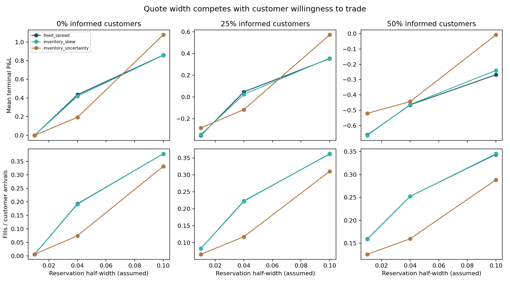

# Market Making Lab

Who trades when a market maker widens its quote? This finite-state binary-contract simulation combines conditional valuation, price-sensitive customer demand, informed order flow, inventory and collateral. All policies are evaluated on shared paths with explicit cash and settlement accounting.

**Finding.** In the prespecified middle demand case, the inventory-plus-uncertainty policy fills **11.75%** of potential arrivals, versus **22.31%** for the fixed spread. Its mean P&L falls from the fixed-spread benchmark of **0.0473** to **−0.1157** currency units per maker account, while its worst-5% loss CVaR improves from **3.9489** to **2.2909**.

[Demand results](reports/demand/REPORT.md) · [Methods](docs/METHODS.md) · [Run the study](#run-the-study)



*Simulated customer demand. The highlighted comparison in the text uses 25% informed flow, reservation width 0.04 and 1,000 shared 100-step paths in the primary seed. Fill rate uses all potential arrivals as its denominator.*

## What drives the tradeoff

The wider quotes collect more spread per accepted fill in that case. They also lose uninformed demand and receive worse one-step markouts. In the legacy model with price-insensitive uninformed customers, the same wider policy led those alternatives on mean P&L at 25% informed flow. The demand report retains **108 predetermined rows** across policies, informed fractions, demand widths and seeds, including 27 inelastic rows.

| Policy | Fill rate | Mean P&L | Worst-5% loss CVaR |
| --- | ---: | ---: | ---: |
| Fixed spread | 22.31% | 0.0473 | 3.9489 |
| Inventory skew | 22.20% | 0.0243 | 2.7769 |
| Inventory + uncertainty | 11.75% | −0.1157 | 2.2909 |

[Paired policy differences](reports/demand/paired_policy_differences.png) · [Legacy inelastic baseline](reports/demo/REPORT.md)

## Model and accounting

Quotes use current conditional fair value and inventory. Uninformed customers accept against a drawn reservation price in the price-sensitive model. Informed customers observe the next state by assumption. Cash, fees, worst-case collateral and inventory limits are checked before settlement. The demand run's maximum terminal attribution residual is **6.71 × 10⁻¹³** currency units. [Worked ledger](docs/WALKTHROUGH.md) · [Implementation](market_making_lab/core.py) · [Tests](tests/test_market.py)

The simulation assumes one potential arrival per step and a declared reservation-price distribution. Policy rankings are conditional on those assumptions. The model has no empirical fill calibration, queue, competing makers or latency estimates.

## Run the study

Use Python 3.12 from the repository root. Activate the virtual environment with `.venv\Scripts\Activate.ps1` in PowerShell or `source .venv/bin/activate` on macOS/Linux.

```bash
python -m venv .venv
# Activate the environment before installing.
python -m pip install -r requirements.lock.txt
python -m pip install --no-deps -e .
python -m pip check
python -m pytest -q tests
python -m market_making_lab --demand-study --output local-runs/demand
```

Use a fresh output directory for each run. The study runs offline after installation. Run `python examples/explain_account.py` for a shorter cash-account walkthrough.

The study was independently constructed. Interest in market making includes the Akuna Capital 2026 Virtual Quant Trading Challenge. The [provenance](docs/PROVENANCE.md) records the boundary between that experience, this public simulation and the AI-assisted implementation and documentation.

[Technical discussion](docs/DISCUSSION.md) · [MIT license](LICENSE) · [Research directory](https://github.com/Mingju-Zhang-CBS/Quant)
