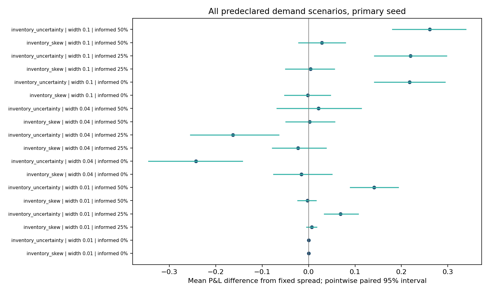

# Price-sensitive order flow

**Executed simulation, no market calibration.** The protocol fixes three policies, three informed-flow fractions, three reservation-price widths and three independent seeds. All 108 rows are retained in [comparison.csv](comparison.csv), including 27 legacy inelastic-demand rows. Each row uses 1,000 shared paths of 100 steps. Quote coefficients remain unchanged from the legacy study.

## Mechanism

An uninformed customer first draws a side, then a reservation value uniformly from fair value plus or minus the declared width. A buyer accepts only ask <= reservation; a seller accepts only bid >= reservation. The draw represents heterogeneous surplus, so reservation values are not truncated at payout bounds. This is an assumption, not a fitted distribution. Informed takers still observe the next state; the maker quotes before observing it. State, side, informed and reservation draws are common across policies.


## Predetermined middle scenario

Primary seed 20261026, width 0.04, informed fraction 25%:

```csv
policy,mean_pnl,fill_rate,loss_cvar_5pct,mean_abs_inventory,spread_capture_per_fill,maker_markout_per_fill
fixed_spread,0.04731299999988802,0.22307,3.9488800000001176,2.11512,0.024034965420718788,0.0008142144110560075
inventory_skew,0.02432099999988796,0.22199,2.7768800000001193,1.6125900000000002,0.023826167692241336,0.00041217751140603157
inventory_uncertainty,-0.11572000000005901,0.1175,2.2909200000000682,0.9858,0.03166690392455692,-0.008838840330403032
```

The narrowest width can remove almost all uninformed trade; an informed customer can still trade against a stale quote. Wider quotes may improve capture on accepted trades while reducing fills and changing adverse-selection exposure. Compare all widths and seeds before interpreting a policy ranking.



## Uncertainty and accounting

[Paired intervals](paired_intervals.csv) bootstrap differences on the same independent simulated paths (2,000 draws). They are pointwise intervals, not multiplicity-adjusted evidence of market profitability. The independent seeds are separately reported rather than pooled after selecting a winner. Model uncertainty dominates sampling precision here.

Maximum cash/NAV bridge error: 2.66e-14; maximum terminal attribution error: 6.71e-13. Fees, short collateral and inventory limits are identical across policies. Fill rate uses every potential arrival as denominator; risk rejection uses proposed fills. Markout is measured one step after execution and is never an input to the quote. [Sample ledgers](sample_ledgers.csv) expose first-path accounting for every primary-seed demand model at 25% informed flow.

## Reproduce and limits

Run `python -m market_making_lab --demand-study --output local-runs/demand` from a clean installation. [protocol.json](protocol.json) records assumed distributions and seeds. There is no queue, competition, latency calibration, intraday quote replay or real execution claim. EOD OptionMetrics quotes are not used to calibrate fills. Zero or negative results are retained.
